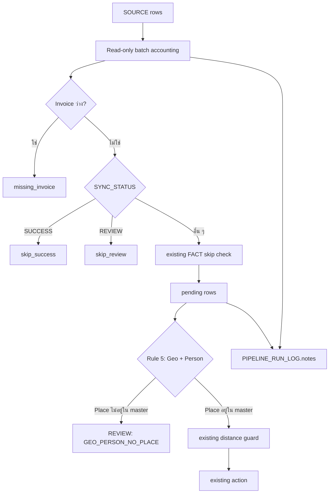

# LMDS V6.0 — รายงานหลักฐานการปรับแก้ R0–R3

> **สถานะหลักฐาน:** การตรวจแบบควบคุมใน local sandbox เท่านั้น ไม่ใช่ผลการทำงานจริงบน Google Sheets และยังไม่มีการ deploy หรือเขียน MASTER_PLACE, FACT_DELIVERY, Q_REVIEW หรือ SOURCE

## PROBLEM

### Issue

การตรวจ baseline R0 จาก acceptance contract พบว่า Rule 5 สามารถให้ `AUTO_MATCH / MATCH_GEO` เมื่อมีหลักฐาน Geo และ Person แต่ไม่มี Place ใน master ซึ่งขัดกับเกณฑ์ที่ยืนยันแล้วว่า **หลักฐานไม่ครบต้องส่ง REVIEW ไม่ใช่เดาเป็น AUTO_MATCH** นอกจากนี้เส้นทาง review/reprocess บางจุดไม่ส่ง `rawAddr` ไปยัง `createPlace()` และ pipeline ไม่มีจำนวนแถว SOURCE ที่ reconcile ได้ก่อนแก้เงื่อนไข skip

### Cause

| รหัส | สาเหตุเชิงเทคนิค | ผลกระทบ |
|---|---|---|
| R1 | `evaluateRule5_GeoPersonAnchor_` ใช้ Geo + Person เป็น anchor โดยไม่รับสถานะ `isPlaceInMaster` | อาจสร้าง/ยืนยันปลายทางที่ไม่มีหลักฐาน Place |
| R2 | `createPlace()` ใน merge, create และ reprocess ไม่ได้รับ `rawAddr` parameter ที่ 6 | อาจไม่เก็บชื่อที่อยู่จาก LatLong เป็น reverse-geocode ของ MASTER_PLACE |
| R3 | SOURCE มีการกรอง `SUCCESS`, `REVIEW`, invoice ว่าง และ FACT-delivery ซ้ำ แต่ไม่มี reconciliation summary ก่อนแก้ filter | อธิบายไม่ได้ครบว่าแถวใดเข้าหรือข้าม pipeline |

**Severity:** MEDIUM — ไม่พบ data loss; มีความเสี่ยงคุณภาพการจับคู่และ traceability หากนำโค้ดเดิมไปใช้จริงโดยไม่ผ่าน review

## ANALYSIS

### หลักการตัดสินใจที่รักษาไว้

1. ไม่เปลี่ยน threshold, alias, master data, source headers, trigger หรือ deployment
2. ไม่แก้เงื่อนไข skip ของ SOURCE ใน R3; เพิ่มเพียง read-only accounting
3. ไม่เพิ่มคอลัมน์ schema ใหม่ โดยใช้ `PIPELINE_RUN_LOG.notes` ที่มีอยู่แล้วสำหรับเก็บ summary
4. คง geo-distance guard เดิมของ Rule 5 หาก Place อยู่ใน master
5. แยก “ผล local code verification” ออกจาก “ผล controlled Google Sheets run” อย่างเด็ดขาด

### Flow หลังการแก้



### Affected Modules

| Module | การเปลี่ยนแปลง |
|---|---|
| `10d_MatchTestHarness.gs` | เพิ่ม acceptance-contract fixtures MP-01 ถึง MP-09 แบบ de-identified และไม่เขียนชีต |
| `01_Config.gs` | เพิ่ม constant `MATCH_GEO_PERSON_NO_PLACE` |
| `10_MatchEngine.gs` | ส่ง master state ให้ Rule 5, เก็บ accounting ใน context และเขียน notes ลง run log |
| `10b_MatchDecision.gs` | Rule 5 fail closed เป็น REVIEW เมื่อไม่มี Place evidence |
| `10g_MatchRowProcessor.gs` | ปรับ comment ให้ตรงกับการ dispatch ใหม่ โดยคง defensive audit flag |
| `10e_MatchResolvePersist.gs` | ส่ง `rawAddr` เข้า `createPlace()` ใน 3 เส้นทาง review/reprocess |
| `04_SourceRepository.gs` | เพิ่ม read-only source accounting และ reconciliation helper |

### Risk Assessment

| มิติ | ระดับ | เหตุผลและมาตรการ |
|---|---|---|
| Regression | Medium | Rule 5 เปลี่ยน decision path เฉพาะกรณีไม่มี Place; ครอบด้วย acceptance contract แต่ต้องทดสอบบน spreadsheet สำเนา |
| Data impact | Low ในขั้นนี้ | ยังไม่เขียนข้อมูลจริงและไม่มี schema migration |
| Runtime | Low | R3 เพิ่ม batch read หนึ่งครั้งต่อ pipeline run เพื่อสร้าง accounting; ไม่ทำ API call ใน loop |
| Traceability | Improved | ทุก run ที่มี context จะเก็บ source totals/skip totals/reconciliation ลง `notes` |

### Related Bugs Checked

* **Bug #8:** raw SCG address และ resolved address ต้องแยกกัน — R2 ส่ง `rawAddr` เฉพาะในบทบาท reverse-geocode โดยไม่เขียนทับ raw source field
* **Bug #9:** ห้ามเก็บ index ที่เปลี่ยนตาม filtered array — R3 ใช้จำนวน aggregate เท่านั้น ไม่มี checkpoint index ใหม่
* **Bug #12:** ใช้ค่า local ที่ยืนยันแล้ว ไม่ใช้ property ที่อาจ undefined — R1 ส่ง state object ที่ dispatcher สร้างจาก resolver result
* **Bug #30:** lock ต้อง release ใน `finally` — R0–R3 ไม่แก้ lifecycle ของ lock หรือ trigger

## PROPOSED FIX — IMPLEMENTED ON REVIEW BRANCH

### R0: Acceptance Contract

MP-01 ถึง MP-09 ถูกเพิ่มเป็น fixtures แบบไม่ระบุตัวตน เพื่อพิสูจน์ decision contract ที่เรียกจากโค้ด GAS ที่สกัดออกมารัน local ได้ จุดสำคัญคือ MP-07 ใช้เป็น baseline ของช่องว่าง Geo + Person แต่ไม่มี Place ก่อน R1 และยืนยันผลใหม่หลัง R1

### R1: Fail Closed สำหรับ Geo + Person ที่ไม่มี Place

```javascript
if (!isPlaceInMaster) {
  return {
    action: 'REVIEW',
    reason: APP_CONST.MATCH_GEO_PERSON_NO_PLACE,
    evidence: evidence + '|no_place'
  };
}
```

ตัวอย่างความหมายเชิงธุรกิจ: ลูกค้าชื่อเดียวกันอาจรับสินค้าที่คนละสถานที่ได้ แม้พิกัดใกล้เคียง; ถ้าไม่พบ Place ที่อยู่ใน master ระบบจึงต้องสร้างหลักฐานให้ reviewer ตัดสินแทนการยืนยันอัตโนมัติ

### R2: รักษา reverse-geocode ผ่านเส้นทาง review/reprocess

`resolveAndPersistMerge_`, `resolveAndPersistCreate_` และ `reprocResolveOrCreatePlaceForReview_` ส่ง `rawAddr` เป็น argument ที่ 6 ของ `createPlace()` แล้ว เพื่อให้ Place Service บันทึก reverse-geocode field ตาม signature ที่มีอยู่

### R3: Source Batch Accounting ที่ไม่แตะ filter

R3 นับ `source_total`, `missing_invoice`, `skip_success`, `skip_review`, `skip_fact`, `pending` และ `reconciled` ก่อน/หลัง loader เดิมทำงาน โดย formula ต้องเป็นจริงดังนี้:

```text
source_total = missing_invoice + skip_success + skip_review + skip_fact + pending
```

ค่าเหล่านี้ถูก serialize ลง `PIPELINE_RUN_LOG.notes` โดยยังใช้ 12 คอลัมน์เดิม ไม่มี migration และไม่มีการเปลี่ยน `getAllSourceRows()` หรือ `getUnprocessedRows()`

## VALIDATION

| การตรวจ | ผล | ขอบเขต |
|---|---:|---|
| R0 acceptance verifier | ผ่าน 6 asserted contracts | โค้ด GAS ใน local VM; MP-07 เปลี่ยนเป็น `REVIEW / GEO_PERSON_NO_PLACE` หลัง R1 |
| R2 reverse-geocode verifier | ผ่าน 3 paths | merge, create และ reprocess ส่ง argument 6 ครบ |
| R3 source accounting verifier | ผ่าน 1 reconciliation control | 5 source rows → 1 invoice ว่าง, 1 success, 1 review, 1 fact skip, 1 pending และ reconcile=true |
| ESLint ทั้ง repository | 0 errors, 43 warnings เดิม | ไม่มี warning ใหม่จาก R0–R3; warnings เป็นโค้ดเดิมนอก scope |
| Prettier ทั้ง repository | ผ่าน | ไฟล์ source ทุกไฟล์ตรงรูปแบบ |
| Google Sheets controlled run | Pending | ต้องใช้ spreadsheet สำเนาที่ผู้ใช้อนุญาตพร้อม Script ID/สิทธิ์ที่เหมาะสม |

### Test Gate สำหรับ Google Sheets สำเนา

1. สร้างสำเนา spreadsheet จริงและยืนยันว่าไม่มีผลกับ production
2. `clasp push` เฉพาะ branch นี้ไปยัง Apps Script ของสำเนา หลังผู้ใช้ให้ Script ID และสิทธิ์
3. รัน dry-run ก่อน แล้วตรวจ `TEST_MATCH_RESULTS`, `Q_REVIEW` และ `PIPELINE_RUN_LOG`
4. ยืนยัน MP-07 บนข้อมูลควบคุมว่าไม่มี FACT AUTO_MATCH สำหรับ `GEO_PERSON_NO_PLACE`
5. ยืนยันว่า R2 เก็บ canonical reverse-geocode ใน MASTER_PLACE เมื่อ reviewer เลือกสร้าง Place
6. ยืนยันว่า totals ใน `PIPELINE_RUN_LOG.notes` reconcile กับ SOURCE ของรอบทดสอบ

### Rollback

* ก่อน merge: ปิด/ลบ branch review ได้โดยไม่กระทบ `main`
* หลัง merge แต่ก่อน production: revert commit เดียวของ R0–R3 และรัน dry-run ใหม่บนสำเนา
* ไม่มี migration, schema change หรือ data write ที่ต้องย้อนข้อมูลในขั้น local verification นี้

## CHANGELOG

**Repository version declared:** `6.0.083`
**Branch:** `manus-acceptance-tests` (สร้างจาก `manus-fix-1`)

| รหัส | สถานะ | ผลที่คาดหวัง |
|---|---|---|
| R0 | Complete | มี acceptance baseline ที่ repeat ได้โดยไม่เขียน sheet |
| R1 | Complete in code | หลักฐาน Geo + Person แต่ไม่มี Place ถูกส่ง REVIEW |
| R2 | Complete in code | เส้นทาง review/reprocess เก็บ reverse-geocode ต่อเนื่อง |
| R3 | Complete in code | ตรวจจำนวน input/skip/pending ได้ก่อนเปลี่ยนนโยบาย filter |

## IMPACT SUMMARY

| รายการ | สถานะ |
|---|---|
| Sheets modified | ไม่มีในขั้นนี้; code รองรับการอ่าน SOURCE และเขียน run-log เฉพาะเมื่อมี controlled pipeline run ในอนาคต |
| Source headers modified | ไม่แก้ |
| Schema/index migration | ไม่มี |
| Cache invalidation | ไม่มี cache key ใหม่และไม่เปลี่ยน chain เดิม |
| Threshold/alias/master data | ไม่แก้ |
| User action required | **ใช่** — ต้องให้ spreadsheet ID ของสำเนาทดสอบและอนุญาตการเชื่อม Apps Script ก่อน test gate ขั้น production-like |
